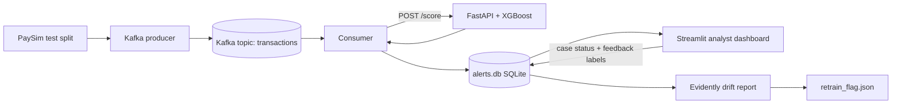

# Real-Time Financial Fraud Detection (PaySim)

A fraud-scoring pipeline built on the PaySim synthetic dataset: feature engineering, an XGBoost model tracked in MLflow, a FastAPI scoring service, a Kafka transaction replay, a graph neural network experiment, an analyst dashboard and drift monitoring.

## Architecture



## Results

All results are on **synthetic data**.

| Item | Result |
|---|---|
| Data | 6.36M transactions, 0.13% fraud (about 774:1). Fraud occurs only in TRANSFER and CASH_OUT. |
| Split | Time-based: train on step <= 600, test on step > 600 |
| XGBoost (test, 43,550 rows, 1,600 fraud) | PR-AUC 0.998, precision 0.985, recall 0.996 (6 missed, 24 false alarms) |
| Class weighting | Without `scale_pos_weight`, recall fell from 0.996 to 0.934 for about 6 fewer false alarms, so the weighted model is used |
| Kafka replay demo (200 transactions, 30 fraud) | 29 fraud caught, 0 false alarms |
| Drift check on the replay | 3 of 4 monitored columns flagged, expected because the demo sample is 15% fraud |

## Findings and limitations

- **PaySim fraud follows a simple rule.** About 96% of the model's importance comes from two features describing how much of the sender's balance is moved (`drains_account`, `amount_to_balance`). The high score reflects the simulator, not real-world difficulty.
- **Leakage was avoided on purpose.** `newbalanceOrig` and `newbalanceDest` reveal the outcome and are not used. The split is by time.
- **History features add almost nothing.** Most senders appear only once, so velocity and amount-versus-average features carry about 0.1% of the importance.
- **There is no device or location data**, so those features from the assignment were not built.
- **No fraud rings in this data.** Almost every sender is unique, fraud receivers are not shared, and only 9 edges connect two fraud transactions.
- **GNN result.** A GraphSAGE model (each transaction linked to the previous one into the same receiver) reached PR-AUC 0.995 against XGBoost's 1.000 on identical nodes. Blending the two gave no gain. The GNN is documented as an experiment and is not part of the scoring API. It should be re-tested on data with shared accounts or devices.
- **The test split has 3.7% fraud**, much more than a live stream, so its precision overstates production performance.
- **The retraining flag only signals.** It reports drift and recommends retraining. It does not retrain anything automatically.
- **Not implemented:** Feast feature store, Kubernetes deployment.

## Project layout

| Path | Purpose |
|---|---|
| `notebooks/01_eda.ipynb` to `05_graph.ipynb` | EDA, features, XGBoost, MLflow, graph experiment |
| `app/main.py` | FastAPI scoring service (`/health`, `/score`) |
| `src/producer.py`, `consumer.py`, `check_topic.py` | Kafka replay, scoring and topic check |
| `src/dashboard.py` | Streamlit analyst dashboard |
| `src/drift_report.py` | Evidently drift report and retraining flag |
| `models/` | Saved XGBoost models and feature list |
| `docker-compose.yml` | Single-broker Kafka |

## How to run

Download PaySim from Kaggle into `dataset/paysim.csv`, then:

```powershell
python -m venv venv
venv\Scripts\activate
pip install -r requirements.txt

# run notebooks 01 to 04 in order to create the splits and the model
docker compose up -d
docker exec kafka /opt/kafka/bin/kafka-topics.sh --create --topic transactions --bootstrap-server localhost:9092

uvicorn app.main:app --reload        # terminal 1
python src/producer.py               # terminal 2
python src/consumer.py
streamlit run src/dashboard.py
python src/drift_report.py
mlflow ui --backend-store-uri sqlite:///mlflow.db --port 5001
```

## Deployment on Kubernetes (Minikube)

The FastAPI scoring service is packaged as a Docker image and deployed to a local Minikube cluster.

```powershell
docker build -t fraud-api:1.0 .
minikube start --driver=docker
minikube image load fraud-api:1.0
kubectl apply -f k8s/fraud-api.yaml
kubectl get pods
minikube service fraud-api --url
```

- `k8s/fraud-api.yaml` holds a Deployment (one replica, with readiness and liveness probes on `/health`) and a NodePort Service.
- The image is loaded straight into Minikube (`imagePullPolicy: Never`), so no container registry is involved.
- **Check:** through the Minikube service address, `/score` returned a fraud probability of 1 for a transfer that drains the sender's balance and 0 for an ordinary cash-out, the same as the local run.

**Scope and limits:** only the scoring API is deployed to Kubernetes. Kafka runs in Docker Compose, and the Streamlit dashboard and drift report run locally. There is one replica, with no autoscaling, ingress or registry. The image runs Python 3.12 with package versions pinned in `requirements-api.txt`, copied from the development environment, which uses Python 3.14.
